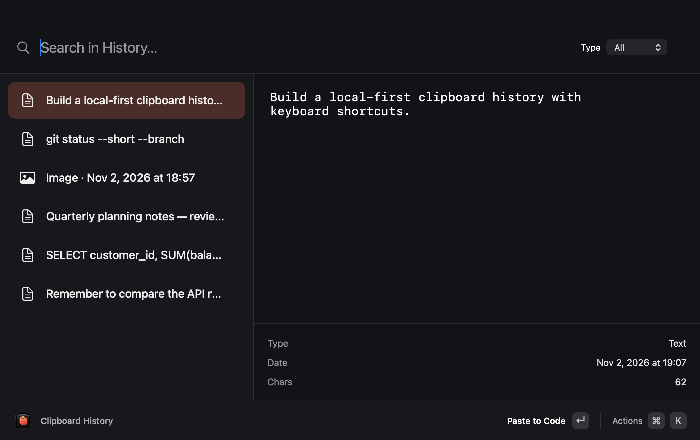
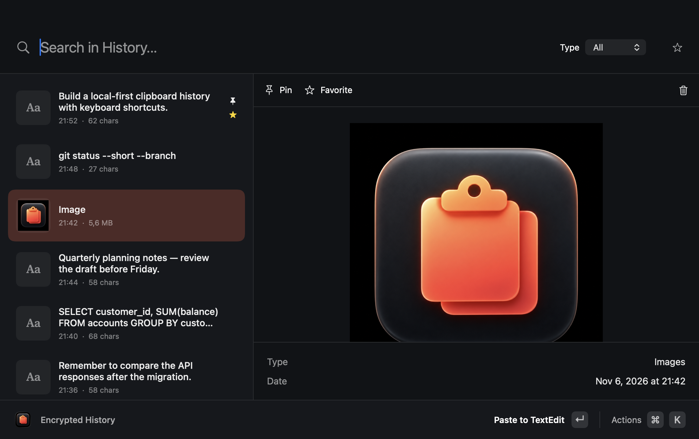

# Clipboard History

A lightweight, open-source clipboard manager for macOS and Windows. It keeps up to **500 entries or 250 MB** by default. Change either limit in **Actions → History Limits…**. Older entries are removed when a limit is reached. History stays on your device; the apps do not sync clipboard contents.





## Features

- Search and browse recent text and images.
- Paste a selected entry into the app you were using.
- Choose a global shortcut and set how many entries and how much storage to keep.
- Run from the macOS menu bar or Windows system tray.
- Keep history local. No account or network connection is used.

Clipboard history can contain passwords and other private information. Clear it from **Actions → Clear History** when needed.

## Privacy controls

History expires after **24 hours** by default, in addition to the entry and storage limits. **Actions → Privacy Settings…** lets you set retention from 1 to 168 hours and add excluded apps (bundle IDs on macOS; process names without `.exe` on Windows). Expired entries and recognizable secrets in existing history are removed on startup and during use.

**Actions → Pause Recording** temporarily stops new captures and stays paused after a restart. Common password-manager apps and clipboard items marked private are excluded. Private-key blocks, common token formats, and authorization headers are also filtered. These checks cannot recognize every secret: pause recording before copying unmarked passwords or other sensitive data. Text inside screenshots is not inspected.

The app stores history locally without application-level encryption. macOS files are restricted to the current user; full-disk encryption protects the disk when it is locked, but other software running as your user may still read history. Copies of the history made outside this app are not expired automatically.

## macOS

Press `⌘⇧Space` to open the history. Use `↑` and `↓` to select an entry, then press `Enter` to paste. `Esc` or the red window button hides the app. Open **Actions → Keyboard Shortcut…** to record a different global shortcut. The new shortcut must include `⌘`, `⌥`, or `⌃`. If another app already uses it, the old shortcut stays active.

Open **Actions → History Limits…** to set the entry limit (100–5000) and storage limit (40–2048 MB). The defaults are 500 entries and 250 MB. The history file and images live in `~/Library/Application Support/ClipboardHistory/`; file access is restricted to your macOS account.

Direct paste requires Accessibility permission for the app in **System Settings → Privacy & Security → Accessibility**. Without it, the selected entry is copied to the clipboard so you can paste with `⌘V`.

Build with Apple Command Line Tools:

```sh
./build.sh
open build/ClipboardHistory.app
```

## Windows

The Windows app runs in the system tray. Press `Ctrl+Shift+Space` to open it. Use `↑` and `↓` to select an entry, then press `Enter` to paste. `Esc` hides the window. Choose **Actions → Keyboard Shortcut…** to record a different shortcut with `Ctrl` or `Alt`. If the shortcut is already taken, the previous one remains active.

Choose **Actions → History Limits…** to set the entry limit (100–5000) and storage limit (40–2048 MB). The defaults are 500 entries and 250 MB. The history and settings are stored in `%LOCALAPPDATA%\ClipboardHistory\`.

Build with the [.NET 10 SDK](https://dotnet.microsoft.com/download/dotnet/10.0):

```powershell
dotnet build windows/ClipboardHistory.Windows.csproj -c Release
```

To publish a standalone x64 executable:

```powershell
dotnet publish windows/ClipboardHistory.Windows.csproj -c Release -r win-x64 --self-contained true -p:PublishSingleFile=true
```

## Build checks

The macOS build runs a small serialization and icon self-check. GitHub Actions builds the Windows project on every push and pull request. The Windows UI still needs hands-on testing on Windows.

## License

MIT. See [LICENSE](LICENSE).
